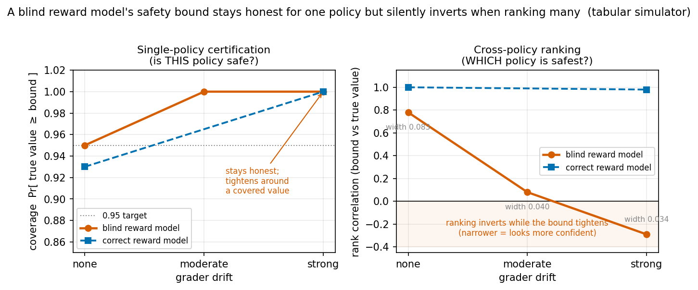
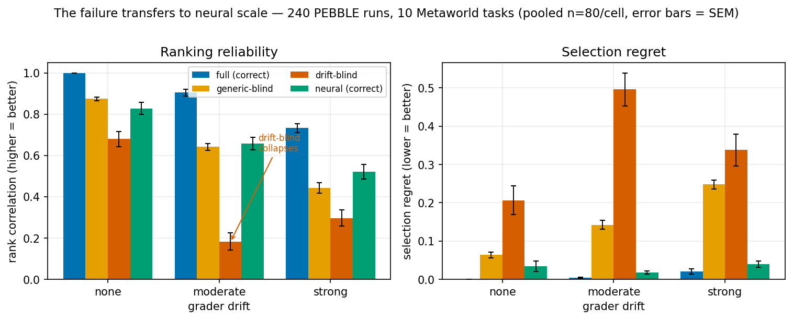
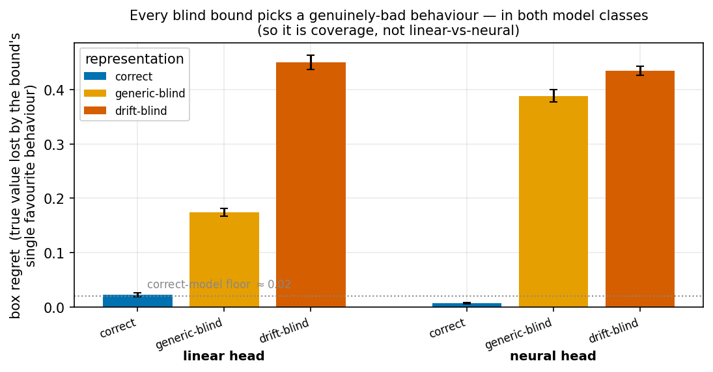
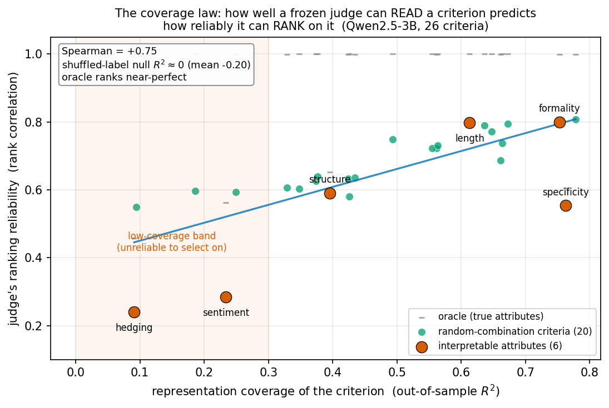
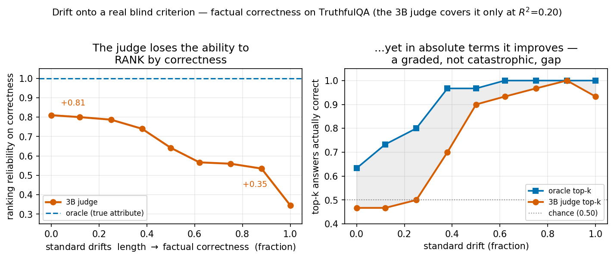

# When the Grader Moves: Why Preference Drift Corrupts *Which*-Policy Ranking but Not *This*-Policy Certification of Reward-Model Safety Bounds

*One-line summary: when the standard used to score behavior changes over time, a popular "worst-case" safety score stays honest about certifying a single policy, but silently gives the wrong answer when used to choose among policies — and only when the reward model cannot represent the criterion the standard drifted toward. That failure is offline-auditable.*

---

## Abstract

Modern AI systems are trained by optimizing a **reward model** — a learned function that imitates the judgments of a **grader** (a human labeler, a large language model (LLM) used as a judge, or a reward model reused across training rounds). A standing worry is that the grader is not fixed: *what it rewards drifts over time*, and it can drift in response to the very behavior the system produces. We ask whether this drift causes the failures it is feared to. Using a controlled small-scale simulator and then a neural-scale check (240 preference-based RL runs on 10 robotics tasks, a real 3-billion-parameter LLM judge, and vision judges), we find that **every dramatic version of the fear fails to reproduce**. What survives is one precise failure. AI-safety work often equips a reward model with a **pessimistic safety score** — a lower bound on a policy's true value computed from the *posterior* over reward functions (the Bayesian-REX construction). We show this score stays honest when asked *"is THIS policy safe?"* but silently **collapses and even inverts** when asked *"WHICH of these policies is safest?"* — but only when the reward model's internal representation **cannot encode the criterion the grader has drifted toward** (rank correlation between the bound and true value falls from 0.78 to −0.29 in simulation, and 0.68 to 0.18 at neural scale, while single-policy certification stays perfect). We trace the cause to a **wrong best-guess (mean) value estimate**, not to a failure of the model's uncertainty — so a defense based on flagging uncertain inputs does not catch it. The threat is narrow and nameable (it needs a reward model that is genuinely blind to the drifted criterion — e.g. a small linear head on frozen features); rich, naturally-trained encoders are robust. Finally, the vulnerability is **auditable offline and without any drift**: how reliably a frozen judge can rank behavior by a criterion is predicted by how well its representation can *read* that criterion (a coverage score; rank correlation +0.75 across 26 criteria). Some important criteria are poorly read — for a 3B judge, *factual correctness* has a coverage of only 0.20 — and drift is simply the silent event that moves an evaluator onto such a criterion while its accuracy dashboard stays green. The practical takeaway shifts from "worry about drift" to "**audit which criteria your judge can actually read.**"

---

## 1. Introduction

Training a policy from preferences has three moving parts: a **grader** that expresses which of two behaviors is better; a **reward model** fit to those preferences; and a **policy** optimized against the reward model. Nearly all analysis assumes the grader is a fixed oracle. In practice it moves. An LLM-as-judge applies a subtly different rubric as the things it scores change; a human labeler tires of a behavior and starts rewarding something else; a reward model reused as the grader for the next training round is itself a moving target. This drift is often **endogenous**: the system's own behavior changes what the grader attends to next — a feedback loop between a policy and the objective it is optimized against.

Two fears follow.

- **Fear 1 — a self-reinforcing spiral.** The system over-produces whatever the grader currently likes; the grader shifts away; the system chases; and so on — so the policy's *true* quality decays while the usual health check (held-out preference accuracy) stays green, because that check is re-measured on the same drifting distribution and moves along with it.
- **Fear 2 — a safety score gone confidently wrong.** A common safety tool puts a probability distribution (a **posterior**) over what the reward function might be, given the preferences seen so far, and reports a **pessimistic lower bound** on a policy's value — the value it would have even under a pessimistic (say, 5th-percentile) reward drawn from that posterior. This is the Bayesian-REX safety bound. The fear is that once the grader moves, this bound becomes *tight* (so it looks trustworthy and confident) yet stops actually bounding the truth.

We test both fears head-on: first in a controlled simulator where every effect can be attributed, then at neural scale. **Contributions:**

1. **A controlled simulator and a neural-scale check.** The simulator separates three axes — is the harm from the *feedback loop*, from *reward over-optimization*, or from the *safety bound*? The neural study re-runs the setup at preference-based-RL scale (240 runs on Metaworld robotics tasks) and with two real frozen judges (a Qwen2.5-3B LLM; ResNet18/DINOv2 vision models).
2. **A battery of nulls (§4):** the feedback loop adds no harm beyond ordinary non-stationarity; reward over-optimization depends on how comparisons are collected, not on drift; the standard health check is not just blind but *anti-informative*; and the safety bound's single-policy guarantee is robust to drift.
3. **One real failure (§5–7):** when the reward model cannot represent the drifted criterion, the safety bound's *cross-policy ranking* silently collapses while its *single-policy certification* stays honest. It transfers from simulation to neural scale across three modalities, we pin its mechanism, and we narrow its scope to a nameable regime.
4. **A practical, drift-free landing (§8):** the vulnerability is a property of the representation, auditable offline — a coverage score predicts a judge's per-criterion reliability, and drift is merely the silent transition onto a low-coverage criterion.

The posture is deflationary-but-precise: the dramatic worries do not reproduce, the reward-over-optimization literature is reconciled, and a single previously-unnamed failure is isolated, scaled, and made auditable.

---

## 2. The setting, in plain terms

We keep the model minimal so every effect can be attributed. Terms are defined at first use.

**Behaviors and features.** There is a set of candidate behaviors (in reinforcement learning from human feedback, RLHF, think responses; in plain reinforcement learning, RL, trajectories). Each behavior $a$ has a fixed **feature vector** $\phi(a)$ — a handful of interpretable, hand-designed axes the grader might care about (e.g. helpfulness, length, formality). In simulation there are $N=256$ behaviors and $d=6$ features; at neural scale $\phi$ is a fixed 6-dimensional summary of a robot trajectory, or the frozen internal representation of an LLM/vision judge.

**The grader and its drift.** The grader has a **weight vector** $w_t$ over the features (nonnegative, summing to one) at round $t$: $w_{t,i}$ is how much it currently cares about feature $i$. Its underlying "true reward" for a behavior is $g_t(a) = w_t \cdot \phi(a)$, and it prefers the higher-scoring of two behaviors, with some noise controlled by a **rationality** parameter (how decisively it acts on small quality differences). **Drift** means $w_t$ changes across rounds. Our main model is **satiation**: the grader gradually *down-weights whatever the system has been over-producing*, so the target moves away from the system's current behavior. This is endogenous (driven by the system's own output) and can *re-order* which behaviors are best, not merely rescale them. A **drift rate** $\lambda$ sets the speed ($\lambda=0$ is static; we use $\lambda \in \{0.5, 1.0\}$ at scale). We call the net change in priorities, $w_T - w_0$, the **drift direction** — the direction in criterion-space that the grader's priorities moved.

**The reward model.** From a growing set of grader comparisons, we fit a reward model $\hat r$ — either a linear function of the features, or a small neural network, or an **ensemble** of models whose disagreement serves as an uncertainty estimate. The policy deployed at each round is a softmax over $\hat r$ (higher-reward behaviors are more likely). Its quality is measured by **regret**: how much true value it loses relative to the best policy achievable *against the current grader* (regret is exactly zero when the policy is handed the true current weights — a sanity floor we verify). Regret rising means genuine over-optimization, not just the goalposts moving.

**The safety bound (Bayesian-REX), stated simply.** Rather than commit to a single reward function, we keep a **posterior** — a probability distribution over reward functions consistent with the preferences seen. For a policy, this induces a distribution over its *possible* true values. The **safety bound** is the pessimistic tail of that distribution — the 5th-percentile value (a "value-at-risk" lower bound). Intuitively: *"even under a pessimistic-but-plausible reward, this policy is at least this good."* Two very different questions use it:

- **Certification** (*is THIS policy safe?*): does the deployed policy's true value actually land above its bound at least 95% of the time? This is a guarantee about **one** policy.
- **Ranking** (*WHICH policy is safest?*): if we score several candidate policies by their bounds, do the bounds order them the same way their true values do? This is the "pick the safest policy" use case, measured by rank correlation between bound and true value.

These are logically independent: a bound can certify each policy correctly yet order them wrongly.

**A blind reward model.** A reward model is **misspecified** when its representation cannot see all $d$ feature axes — it effectively works in a lower-dimensional projection and is *structurally blind* to some directions. This is the norm, not a corner case: real reward models are finite-capacity feature extractors. We compare three regimes: **full** (sees all features — correctly specified), **generic-blind** (blind to a random direction), and **drift-blind** (blind specifically to the drift direction — the worst case). We also test nonlinear (neural) versions of each.

**A note on scale (why ranking is the robust object).** Preferences only reveal the reward up to a scale and an offset: doubling the reward and halving the grader's rationality gives identical preferences, and adding a constant to all rewards changes nothing. So the *absolute* numbers a reward model produces are meaningful only if the rationality parameter is known and the weights are normalized. **Certification depends on this** — it compares an absolute bound to an absolute value, and getting the scale wrong (we find a ±50% error suffices) flips the guarantee between "always holds" and "always fails." **Ranking does not.** The unknown scale multiplies *every* policy's bound by the same factor and the unknown offset adds the same constant to every policy (because the directions along which policies differ are exactly the directions preferences constrain) — a shared rescaling that leaves the *ordering* untouched. So ranking is immune to the scale ambiguity that makes certification fragile. Crucially, this immunity is *only* to the scale/offset nuisance — **not** to a blind representation, which distorts different policies by different amounts and genuinely re-orders them. That distortion is the failure this paper isolates. (At neural scale the reward model's output additionally carries exactly such an unidentified additive offset, a further reason we compare policies by rank rather than by absolute bound there.)

---

## 3. What we ran

**Simulator.** Each run is 100 rounds: deploy the current policy; collect 64 grader comparisons (either **on-policy** — drawn from the policy's own behavior, as in the PEBBLE algorithm — or **broad** — drawn across all behaviors); refit the reward model / posterior; advance the grader's weights from the system's recent feature usage. We report end-of-run averages over 8–40 random seeds with confidence intervals. Two controls isolate the *feedback loop*: **replay** (feed the reward model the same weight trajectory but pre-recorded, so drift happens without the loop) and a passive-vs-active learner comparison. A 20-check sanity suite passes.

**Neural scale check.** *Robotics:* 10 tasks from Metaworld (a standard robotic-manipulation benchmark) × 8 seeds × {no drift, moderate drift, strong drift}, 300k steps each, trained with PEBBLE preference-based RL — **240 runs**. A scripted grader scores trajectory segments by a drifting weighting of a fixed 6-feature summary; the three reward-model regimes (full / generic-blind / drift-blind, plus neural versions) are applied *after* training, so all runs share identical training and differ only in the decision-maker's reward model. *Text:* a frozen Qwen2.5 large language model (3 billion parameters) as judge (its mean-pooled hidden state as the representation) with a Bayesian linear head — the exact safety-bound structure, on a real LLM; 1,500 responses, a drifting evaluation standard. *Vision:* a frozen ImageNet-pretrained ResNet18 (an 18-layer convolutional vision network) and a self-supervised DINOv2 vision model as judges on images, drifting standard.

---

## 4. The fears that do not reproduce

Four pre-registered fears fail; each null rules out a confound or reconciles a prior claim.

**4.1 The feedback loop adds no harm beyond ordinary non-stationarity.** Across 8 paired tests, closing the loop (letting the system's behavior drive the grader) produces regret statistically indistinguishable from *replaying the same drift open-loop*. The loop is real but inert as a harm amplifier — the dramatic "the system games its own objective into a spiral" story requires the loop to do work beyond the drift itself, and it does not.

**4.2 Reward over-optimization depends on how comparisons are collected, not on drift.** A correctly-specified linear reward model shows negligible over-optimization. A neural reward model over-optimizes (true value falls while proxy rises) **only** when comparisons are collected narrowly (on-policy) so that off-behavior regions are starved of data — an effect that is flat across a 7.5× training-budget increase (so it is a data-coverage artifact, not under-fitting) and *vanishes* when comparisons are collected broadly. This reconciles the over-optimization literature: broad collection, the norm in control settings, closes the gate.

**4.3 The standard health check is anti-informative; a fixed probe fixes it.** Held-out preference accuracy moves the *wrong way* — it *rises* (71%→76%) as true regret rises — because it is re-elicited on the drifting distribution and co-moves with it. Any *fixed* set of probe comparisons, re-labeled over time, detects the drift with near-certainty. *(This is a known result — reward-model accuracy is a poor proxy for policy quality [Razin et al. 2025; Wang et al. 2025], and drift detection needs a fixed reference [Gama et al. 2014]. We include it as a confirmed component, not a contribution.)*

**4.4 The safety bound's single-policy certification is robust to drift.** Does drift push the bound into the feared "confidently wrong" corner — tight yet no longer covering the truth? No. Across drift rates, in both correctly-specified and blind reward models, certification stays ≥95% and *rises to 100%* as drift grows; the bound *tightens around a value that stays covered*, rather than uncovering it:

| reward model | drift | certification | ranking | bound width | regret |
|---|---:|---:|---:|---:|---:|
| full (correct) | none | 0.93 | 1.00 | 0.14 | 0.00 |
| full | strong | **1.00** | 0.98 | 0.11 | 0.06 |
| blind ($k<d$) | none | 0.95 | 0.78 | 0.083 | 0.09 |
| blind | moderate | **1.00** | 0.08 | 0.040 | 0.37 |
| blind | strong | **1.00** | **−0.29** | 0.034 | 0.38 |

The "confidently wrong" quadrant never appears for *certification*. (Two further fears also fail: a conservative "mean-minus-uncertainty" objective does **not** backfire for the ensembles used in practice; and giving the reward model more capacity does **not** amplify the failure — it only inflates the posterior until the bound is vacuously loose.)

---

## 5. The one real failure: ranking collapses when the model is blind to the drift

Look at the **ranking** column of the table above, not certification. When the reward model is correctly specified, ranking is robust (≥0.98) at every drift rate. When it is **blind**, ranking **collapses and then inverts** as drift grows — rank correlation $0.78 \to 0.08 \to -0.29$ — *while certification stays at 100% and the bound gets tighter*. The bound becomes **confidently mis-ordered**: perfectly honest about each policy in isolation, yet, asked to pick the safest of several alternatives, it returns an increasingly *reversed* ranking with *narrower, more confident-looking* intervals.

The two questions come apart because they load different things. Certifying the deployed policy asks about a value the collected comparisons surround, so it stays calibrated. Ranking *alternative* policies depends on exactly the direction the grader drifted toward — and a reward model blind to that direction cannot tell those alternatives apart there. **For certifying a fixed policy, drift is not the threat it is feared to be. For choosing among policies under a blind representation, drift silently destroys the very thing you are using the bound for — and its shrinking width disguises the failure as growing confidence.**

**Figure 1 — The core dissociation (tabular simulator, 8–40 seeds).** As the grader drifts (none → moderate → strong), a reward model *blind* to the drift direction keeps its **single-policy certification** honest (left) — coverage stays ≥0.95 and climbs to 1.00 while the bound actually *tightens* (width 0.083 → 0.034) — yet its **cross-policy ranking** collapses and inverts (right, 0.78 → −0.29). A correctly-specified model stays reliable on both. The bound becomes *confidently mis-ordered*: narrower, more confident-looking intervals wrapped around a reversed ranking.

---

## 6. It holds at neural scale, and it is about the representation

**Transfer (240 runs, 10 tasks, pooled n=80; regret lower-is-better / rank correlation higher-is-better, at no / moderate / strong drift):**

| reward model | selection regret | rank correlation |
|---|---|---|
| full (correct) | 0.00 / 0.00 / 0.02 | 1.00 / 0.91 / 0.73 |
| generic-blind | 0.06 / 0.14 / 0.25 | 0.88 / 0.64 / 0.44 |
| drift-blind | 0.21 / **0.50** / 0.34 | 0.68 / **0.18** / 0.30 |
| neural, correct | 0.03 / 0.02 / 0.04 | 0.83 / 0.66 / 0.52 |

The drift-blind reward model's ranking collapses (0.68→0.18), mirroring the simulation. (It bites hardest at *moderate* drift because a model blind only to the net drift direction fails most when the drift is a coherent straight march along that one direction; at strong drift the priorities wander across several directions, so a single-direction blindness misses less — §7.)

**Figure 2 — The failure transfers to neural scale.** 240 PEBBLE runs on 10 Metaworld tasks (pooled *n*=80 per cell; error bars SEM). Ranking reliability (left) falls with both representation blindness and drift; the drift-blind bound collapses at moderate drift (0.68 → 0.18). Selection regret (right) mirrors it. A correct *neural* head behaves like the correct linear one — model capacity is not the axis that matters; coverage is.

**It is coverage of the drift direction, not model class.** Repeating the full/generic-blind/drift-blind comparison with *neural* reward models gives the same pattern — correct representation robust, blind representation fails — in both the linear and neural families:

| | correct | generic-blind | drift-blind |
|---|---|---|---|
| **linear** | 1.00 / 0.91 / 0.73 | 0.88 / 0.64 / 0.44 | 0.68 / **0.18** / 0.30 |
| **neural** | 0.83 / 0.66 / 0.52 | 0.43 / 0.27 / 0.18 | 0.49 / 0.36 / 0.30 |

So *"just use a neural reward model"* does not fix it; what governs the failure is whether the representation can encode the drifted criterion.

**It really is exploitable (reward hacking).** Two probes confirm the failure has teeth. (i) We insert a **planted bad policy** whose true value collapsed along the drift direction: under drift, the drift-blind bound *deploys* it 36% of the time, while correct models never do. (ii) We let each bound pick its single favorite behavior from the achievable range: correctly-specified bounds pick a genuinely-good one, every blind bound picks a genuinely-bad one — and this second effect holds even without drift, because it is about the representation's blind spots, not the drift.

**Figure 3 — The blind bounds are genuinely exploitable.** Allowed to pick its single favourite behaviour, every reduced-representation bound selects a much worse one (higher "box regret") than the correct model's ≈0.02 floor — in *both* the linear- and neural-head families (pooled over drift levels; error bars SEM). The culprit is representation coverage, not model class.

**Two things the uniform simulation could not see.** (i) *Task geometry matters:* on the `hammer` task even the correct model degrades under drift (1.00→0.35). (ii) *Realistic multi-run selection magnifies the harm:* practitioners pick the best of several training runs, whose behaviors are more spread out — and there even the correctly-specified model is not immune at strong drift (regret 0.007 → 0.211).

---

## 7. Why it happens: a wrong best guess, not a failure of uncertainty

A natural hypothesis is that the safety bound fails because it becomes *over-confident* — its uncertainty collapses, so its pessimistic tail no longer reaches the truth. **We tested this directly and it is false.**

To probe the mechanism, we construct a **stale trap policy**: an extreme behavior that scores high on exactly the features the grader *used to* reward but has since *devalued*, and low on the features it *now* rewards. Under the current grader this policy is genuinely poor — but it is poor *only* along the drift direction, which is precisely the direction a drift-blind model cannot see. We then ask: when the *correct* model correctly avoids this trap, does it do so because its uncertainty spikes there (an "this input is unfamiliar" flag), or because its best-guess value is simply low?

The answer is the best guess. The correct model's uncertainty at the trap is **not elevated** (its pessimism-margin there is 0.76× the margin on ordinary behaviors — if anything *smaller*); it avoids the trap because its **mean value estimate**, having recovered the current grader, correctly rates it low. The drift-blind model, unable to see the drift direction, gives the trap a wrongly *high* mean value. **So the failure is a biased point estimate of a representation that cannot track the drifted criterion — not a failure of the uncertainty estimate.** This matters practically: a safety mechanism that refuses uncertain inputs (a "no-op when unsure" defense, as in the original Bayesian-REX) does *not* catch this failure, because the bad policy does not look uncertain — it looks confidently good.

*(We also tried a geometric diagnostic — whether drift enters a direction the comparisons under-constrain — but it did not explain the pattern: it read 0.67 at strong drift yet 1.08 — "not a blind spot" — at moderate drift, exactly where the failure is worst. What did explain it was whether the drift was a coherent straight march the single-direction blindness could summarize: the drift path's straightness falls from 0.63 to 0.47 as drift strengthens, and the worst failure tracks the straighter (moderate-drift) path.)*

**The threat is narrow and nameable.** A representation *learned* on early data and then frozen does drop the drift direction to some degree, yet it is **not** exploitable in practice — a frozen encoder ranks about as well as a freshly-trained one, and is not fooled by the trap policy. Only *severe* collapse fails: a one-unit unbounded-activation bottleneck is genuinely exploitable — a "favorite-pick" regret of **0.77**, versus ≈0.00–0.06 for correct models and 0.13–0.53 for ordinary blind ones — while bounded activations stay ≤0.26. So the reproducible failure needs one of: **(a) a representation deliberately blind to the drift direction, (b) a severely collapsed bottleneck, or (c) a reward model fit on already-drift-contaminated data.** The realistic dangerous case is specifically a **small linear head on frozen features** — the Bayesian-REX structure itself — not "any imperfect reward model."

---

## 8. The practical landing: audit which criteria your judge can read (no drift required)

§7 shows drift is *not* generically dangerous: a rich representation encodes most directions, so drifting onto a random one is harmless. So when *should* you worry? The answer is a property of the representation, checkable offline:

> **The coverage law.** How reliably a frozen judge can rank behavior by a criterion is predicted by how well its representation can *read* that criterion — a **coverage score** (the out-of-sample $R^2$ — the fraction of the criterion's variance the representation can predict — of the criterion from the frozen representation). This is testable offline, **with no drift at all**.

We verify it on a real LLM judge across **26 criteria** (6 interpretable attributes plus 20 random combinations): the coverage score predicts the judge's ranking reliability with **rank correlation +0.75** (a shuffled-label control gives ≈0, ruling out overfitting; an oracle with the true attributes ranks near-perfectly (≈0.93), confirming the criteria are rankable in principle and only the judge's coverage limits it). Crucially, **some important criteria are poorly covered**: for the 3B judge, *factual correctness* has a coverage of only **0.20** and *hedging* **0.01**. A practitioner who simply *chooses* to rank answers by factual correctness hits the wall immediately — no drift needed.

**Figure 4 — The coverage law (frozen Qwen2.5-3B judge, 26 criteria).** How well the representation can *read* a criterion (out-of-sample R², x-axis) predicts how reliably the judge can *rank* on it (y-axis): Spearman **+0.75**. A shuffled-label null sits at ≈0 (the probe is not overfitting) and an oracle using the true attributes ranks near-perfectly, so only the judge's coverage limits it. In this synthetic-attribute run the poorly-read attributes are *hedging* (R²≈0.09) and *sentiment* (≈0.23); the shaded band marks criteria that are unreliable to select on. (The *factual-correctness* example in the text is the separate TruthfulQA probe of Fig 5.)

**Where drift re-enters:** as the *silent transition* onto such a criterion. When an evaluation standard evolves — say, evaluators gradually come to weight factual correctness more — a previously-fine judge silently becomes unreliable on the new criterion (its correctness-ranking degrades 0.81→0.35), while its **accuracy dashboard stays green** because no one re-audits. This is exactly why "drift is generically safe" (§7) does not defuse the concern: the danger is not generic drift, it is an evolving standard landing on a *specific, important, low-coverage* criterion — which the audit flags in advance. (Real failures are *graded*, not catastrophic: a capable judge partially reads even hard criteria, so it degrades rather than collapses — a mildly reassuring caveat.) The lever shifts from "understand drift" to **"audit per-criterion coverage; treat low-coverage criteria as unreliable to select on."** No head fix — more capacity, nonlinearity, or the uncertainty bound — closes a coverage gap.

**Figure 5 — Drift onto a *real* blind criterion.** On TruthfulQA the 3B judge covers factual correctness only at R²=0.20. As the evaluation standard drifts from length (well-read) onto correctness, the judge's **ranking** by correctness degrades from +0.81 to +0.35 while an oracle stays perfect (left) — it silently loses the ability to order answers by the newly-important criterion. In *absolute* top-k terms it still improves as correctness is up-weighted (right), so the failure is **graded, not catastrophic** — but the fine-grained ordering that selection relies on is exactly what erodes.

---

## 9. Selection versus optimization — and why the failure does not transfer

Everything above concerns *selection*: ranking a set of already-trained policies. A separate question is whether the same coverage failure appears in *optimization* — training a policy against a drift-blind reward model. We could **not** construct the analogous failure (a policy protected from following a bad drift because its reward model cannot represent the drifted criterion), and we now argue this is **structural, not a gap in effort**.

The link is between the two "beyond-accuracy" reward-model properties. For a linear head on frozen features, *being able to read a criterion (coverage) is a precondition for the reward to vary along that criterion*: if the representation cannot express the drift direction, the reward is **flat** along it. And a flat reward gives a flat optimization landscape with no gradient to follow [Razin et al. 2025]. So the two failure modes **coincide**: the very direction a blind reward model cannot *rank* on is the direction along which it induces a *flat* landscape — so a policy optimized against it gets no signal to move there. This is exactly the tension we observed empirically: a drift target strong enough to redirect a policy is one every reward model can represent (no blind spot), while a target the model is blind to is flat and cannot redirect the policy at all. **Selection-side coverage failure therefore does not transfer to a redirect-able optimization failure — coverage failure *is* optimization flatness.** (Tight for linear heads; a conjecture for nonlinear ones.) The coverage claim thus rests, correctly, on the selection side.

---

## 10. Related work

**Reward over-optimization / Goodhart's law** (Gao et al. 2023, for a static gold reward; *Goodhart's law*: once a measure becomes a target it stops being a good measure): we add that in preference-based RL the effect is gated on collection breadth, explaining its absence in broad-coverage control settings. **Passive-vs-active learning** (Ostrovski, Castro & Dabney 2021): we reuse the design and find the reward-learning version of the effect largely vanishes. **Bayesian reward learning / value-at-risk** (Brown et al., Bayesian-REX and BROIL; T-REX): this is exactly the safety bound we stress-test; our contribution is its single-policy robustness *and* its ranking fragility once the grader moves and the representation is blind — a failure its "refuse uncertain inputs" defense does not catch. **Preference-based RL systems** (PEBBLE, B-Pref): the on-policy protocol we match. **Non-stationary / performative rewards**: motivate endogenous drift; our null says the *loop itself* is not the harm amplifier.

**Beyond-accuracy reward-model quality.** A parallel line shows reward-model *accuracy* is insufficient to characterize a good teacher. Razin et al. (2025, *What Makes a Reward Model a Good Teacher?*) prove that a low-reward-**variance** model induces a flat optimization landscape (slow convergence even when perfectly accurate); Wang et al. (2025) show held-out accuracy weakly predicts downstream policy performance. Our axis is **orthogonal and complementary**: their *reward variance* governs **optimization** (a static setting), while our *representation coverage* governs **ranking and certification under drift** (selection). §9 shows the two coincide — an unreadable criterion is both un-rankable and flat to optimize.

**Novelty.** (1) The **certification-versus-ranking split** of a reward-posterior safety bound under grader drift — single-policy certification stays perfect (even tightening) while cross-policy ranking inverts under a blind representation — articulated, mechanism-pinned (biased mean, not uncertainty), and scale-checked. (2) A **drift-independent, offline-auditable coverage law** relating per-criterion representation coverage to ranking reliability, verified on a real LLM judge (+0.75 across 26 criteria) with the same principle shown qualitatively for robotics and vision judges.

---

## 11. Limitations and threats to validity

- **The scale check tempers, not just confirms.** The ranking failure *does* transfer to neural scale, but with caveats the simulation could not see: **task-geometry heterogeneity** (some tasks make even the correct model degrade), **modality-dependence** (rich frozen LLM/vision judges show *no* drift-*specific* blind spot — the drift direction is covered *at least as well as* a random one, e.g. 0.56 vs 0.44 for the LLM), and the need for a **deliberately blind or narrow** reward model rather than generic imperfection. The failure is therefore *nameable and bounded*, not universal.
- **Certification at neural scale is a conceptual, not re-measured, claim.** We measure single-policy certification directly only in the simulator; at neural scale we measure ranking and regret. "Certification stays honest" transfers as an argument, not an independently re-measured neural number.
- **The certification guarantee needs a known scale.** As in §2, the single-policy guarantee is well-posed only if the grader's rationality is known and weights normalized; a ±50% error flips it. Real graders' rationality is unknown, heterogeneous, and can itself drift — so **the certification number is fragile in practice**, whereas the ranking result and the coverage audit are scale-free and therefore the deployable tools. (This is a stronger reason to lean on ranking/coverage than on the certificate.)
- **Certification robustness is scoped to policies near the comparison support.** A held-out test (certify policies never deployed and absent from the comparison set) shows the "certification stays honest" result is a property of *on-support* policies — which, by construction, includes the deployed policy the guarantee is actually used for. Policies placed adversarially *off* support (e.g. worst-along-the-drift-direction) are **under-covered even by the correctly-specified model** (coverage falls to ≈0.5 as drift grows), because on-policy collection starves the directions those policies differ along. Crucially this is a *different* axis from the ranking failure: off-support under-coverage appears even when the representation is correct (ranking intact), and ranking inversion appears even on-support (certification intact) — so the certification/ranking split is a genuine two-axis phenomenon, not a single covariate-shift effect. The honest statement of §4.4/§5 is therefore "certification is robust *for policies the comparisons surround*," with off-support certification governed by data coverage in policy space, mirroring the representation-coverage story for ranking.
- **Selection-only for the coverage claim.** Coverage is verified to govern *selection*; the optimization side is argued (§9) to coincide, not separately measured.
- **One drift model.** We study satiation drift; adversarial or reward-hacking-style grader dynamics may differ.

**Bottom line.** A reward-posterior safety bound is *more* robust to grader drift than feared when used to **certify a fixed policy**, and *less* robust than it looks when used to **choose among policies** with a representation blind to the drifted criterion — where its ranking silently inverts while its intervals tighten. The dangerous regime is nameable (a small linear head on frozen features), not universal, and the safeguard is offline and drift-free: **audit how well each judge can read each criterion, treat low-coverage criteria as unreliable to rank on, and pair any bound with a fixed-probe drift monitor.**

---

### Appendix — summary of hypotheses

| Fear | Verdict |
|---|---|
| The feedback loop amplifies harm | **Null** (8 paired tests) |
| Drift causes true-reward collapse | **Gated on collection breadth**, absent under broad collection |
| The standard health check misses it | **Anti-informative**; a fixed probe detects it |
| Drift → tight-but-uncovered safety bound | **Null**; single-policy certification robust, over-covers |
| **Ranking collapse** (our finding) | **Ranking inverts** under a blind representation + drift (sim 0.78→−0.29; neural 0.68→0.18) while certification stays honest |
| A conservative penalty backfires | **Null** for the ensembles used in practice |
| More capacity amplifies the failure | **Null**; larger models only loosen the bound |
| **Coverage law** (our finding) | Per-criterion coverage predicts ranking reliability (**+0.75**, 26 criteria), drift-independent |

*Artifacts.* Simulator in `drifted_grader/`; neural code in `NeuralDriftedGrader/`; analyzers in `analysis/`; full numbers in `EXPERIMENT_LOG.md` and the `stageF_scaleup/` results directories. Figures 1–5 (`md_files/figures/`) are regenerable from the stored results alone via `python -m analysis.paper_figures` — Fig 1 from the tabular Plan-02 VaR aggregates, Figs 2–3 from `stageF_scaleup/results{,_hack}/per_run.csv` (n=80), Fig 4 from the coverage-law `law.json`, Fig 5 from the TruthfulQA `semantic/sem.json`.
